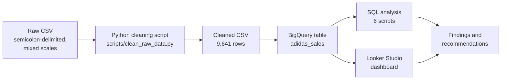

# 👟 Adidas US Sales Analysis — Margin, Channel & Retailer Performance

Repairing a corrupted raw sales file, then analyzing about 9,600 Adidas retail transactions across the US (2020–2021) to find where revenue comes from and where margin is won or lost, using SQL (BigQuery) and a one-page Looker Studio dashboard.

> **Disclaimer:** This is an independent portfolio project. It is not affiliated with, endorsed by, or connected to Adidas. All values are in USD (inferred from the `$` symbol in the raw file).

### 📌 Table of Contents

- [Overview](#overview)
- [Objective](#objective)
- [Dataset](#dataset)
- [Tools & Technologies](#tools--technologies)
- [Project Structure](#project-structure)
- [Data Model](#data-model)
- [SQL Analysis](#sql-analysis)
- [Key Findings](#key-findings)
- [Dashboard](#dashboard)
- [Project Workflow](#project-workflow)
- [Business Recommendations](#business-recommendations)
- [Data Notes & Challenges](#data-notes--challenges)
- [How to Run This Project](#how-to-run-this-project)
- [Author & Contact](#author--contact)

---

### Overview

This project covers the full path from a broken CSV to a business answer. The raw file used a semicolon delimiter and stored its numeric columns on inconsistent scales, so the first job was repairing it and proving the repair worked. The cleaned table (9,641 rows, one per transaction) was then loaded into BigQuery, where six SQL scripts answer questions about revenue, profit, margin, retailers, products, regions, sales channels, and time. The results are summarized in a single-page Looker Studio dashboard.

**Headline numbers (cleaned data):** $120.0M revenue, $47.2M operating profit, a 39.31% operating margin, and 2.48M units sold across 6 retailers, 5 regions, 50 states, and 6 products.

### Objective

A sales team needs more than a revenue total. The goal here is to answer the questions that change decisions: which regions, retailers, and products bring in the most revenue, whether the biggest ones are also the most profitable, which sales channel earns the best margin, and how far the data can be trusted for trend analysis. Every finding is tied to a query in this repo, and the limits of the data are stated rather than hidden.

### Dataset

**Source:** [add the dataset link and license here]. The raw file was delivered "uncleaned" (`data_sales.csv`, semicolon-separated).

**Size:** 9,641 transactions | **Period:** 2020-01-01 to 2021-12-31 | **Grain:** one row per sales transaction

| Column | Type | Description |
| --- | --- | --- |
| retailer | STRING | Retail partner that sold the product (6 retailers) |
| retailer_id | INT | Retailer identifier |
| invoice_date | DATE | Date of the sale |
| region | STRING | US region (5 regions) |
| state | STRING | US state (50 states) |
| city | STRING | City (52 cities) |
| product | STRING | Product line (6 products) |
| price_per_unit | NUMERIC | Price of one unit, USD |
| units_sold | INT | Units sold in the transaction |
| operating_profit | NUMERIC | Operating profit of the transaction, USD |
| sales_method | STRING | Online, Outlet, or In-store |
| total_sales | NUMERIC | Revenue = `price_per_unit × units_sold`, USD (recomputed, see Data Notes) |

The raw file is **not** included in this repository. The cleaned table is in `data/` and the script that produced it is in `scripts/`.

### Tools & Technologies

- **Google BigQuery** — data warehouse and SQL execution
- **SQL** — aggregation, `GROUP BY`, CTEs, window functions (`RANK`, `LAG`, `SUM() OVER`), `SAFE_DIVIDE`
- **Looker Studio** — one-page interactive dashboard
- **Python (pandas)** — one-time repair of the raw file, kept as a reproducible script
- **GitHub** — version control and portfolio

### Project Structure

```
adidas-us-sales-analysis/
│
├── data/
│   └── adidas_sales_clean_v2.csv        # cleaned table (9,641 rows)
│
├── scripts/
│   └── clean_raw_data.py                # reproducible repair of the raw file
│
├── sql/
│   ├── 02_kpi_overview.sql              # profile, headline KPIs, integrity checks
│   ├── 03_contribution_analysis.sql     # revenue/profit share by region, retailer, product, state
│   ├── 04_margin_analysis.sql           # revenue rank vs margin rank
│   ├── 05_sales_channel.sql             # Online vs Outlet vs In-store
│   ├── 06_time_trend.sql                # monthly series and like-for-like check
│   └── 07_original_finding.sql          # region x product and state margin pockets
│
├── images/                              # dashboard screenshots
│   └── dashboard_overview.png
│
└── README.md
```

### Data Model

A single fact-style table, `adidas_sales`, with one row per transaction. All ratios in this project are computed from totals (see below), never by averaging row-level values.

| KPI | Definition |
| --- | --- |
| Revenue | `SUM(total_sales)` |
| Profit | `SUM(operating_profit)` |
| Margin (%) | `SUM(operating_profit) / SUM(total_sales)` |
| Units | `SUM(units_sold)` |
| Avg price per unit | `SUM(total_sales) / SUM(units_sold)` |
| Revenue per transaction | `SUM(total_sales) / COUNT(*)` |

Margin is deliberately a weighted ratio. Averaging each row's margin gives 42.30%, while the correct total-based margin is 39.31%, because small transactions tend to carry higher margins and would otherwise be over-weighted.

### SQL Analysis

Six scripts, each opening with the business question, the approach, and a one-line finding.

| Script | Focus | Example question answered |
| --- | --- | --- |
| `02_kpi_overview.sql` | Profile and KPIs | How big is the dataset, what are revenue, profit, and margin, and does `total_sales` equal price × units on every row? |
| `03_contribution_analysis.sql` | Contribution | Which region, retailer, product, and state contribute most, and how concentrated is revenue in the top 3 retailers? |
| `04_margin_analysis.sql` | Margin | Which products and retailers rank high on revenue but low on margin? |
| `05_sales_channel.sql` | Sales channel | How do Online, Outlet, and In-store compare, and does the pattern hold in every region? |
| `06_time_trend.sql` | Time | How do revenue and margin move monthly, and is a 2020 vs 2021 comparison fair? |
| `07_original_finding.sql` | Exploration | Where are the unusually low- or high-margin region × product and state combinations? |

### Key Findings

**Overall**

- $120.0M revenue, $47.2M operating profit, and a 39.31% margin on 2.48M units, from 9,641 transactions
- Average price is $48.47 per unit and average revenue is about $12.4K per transaction

**Regions**

- West is the largest region (30.3% of revenue) but has the **lowest margin** (35.74%)
- South ranks fourth by revenue (17.1%) but has the **highest margin** (44.79%)
- Northeast (20.9%), Southeast (17.8%), and Midwest (13.9%) sit in between, with margins from 38.8% to 41.2%

**Retailers**

- The top 3 retailers (West Gear, Foot Locker, Sports Direct) generate **71.6%** of revenue
- West Gear is #1 by revenue (26.9%) but only #5 by margin (37.65%)
- Sports Direct is #3 by revenue (20.5%) but has the **best margin** (43.25%)
- Amazon is the smallest retailer by revenue (8.4%) yet has the second-best margin (39.46%)

**Products**

- Men's Street Footwear leads on both revenue (23.1%) and margin (42.01%)
- Men's Athletic Footwear is #3 by revenue (17.1%) but has the **lowest margin** (36.15%)

**Sales channels**

- Online has the best margin (43.48%), generates 37.5% of revenue, and accounts for 50.7% of transactions
- Outlet earns a 37.74% margin and In-store the lowest at 35.78%
- Online has the highest margin in **all five regions**
- Average revenue per transaction differs sharply: Online about $9.2K, Outlet about $13.1K, In-store about $20.5K

**Margin pockets**

- The same product can behave very differently by region: Women's Apparel earns a 52.05% margin in the South but 29.90% in the West (both with 288 or more transactions)
- Among states with at least 100 transactions, margin ranges from 28.52% (Hawaii) to 54.44% (Alabama)

**Time coverage (read before using any trend)**

- 2020 contains 1,299 transactions across 9 states with 5 retailers (Amazon has none and Kohl's has only 8 rows); 2021 contains 8,342 transactions across 46 states with all 6 retailers
- Even when restricted to the 13 retailer–region combinations present in both years, rows rise from 1,233 to 5,492, so the jump is **not** evidence of business growth and most likely reflects how the data was collected
- On that like-for-like set, margin is 37.35% in 2020 and 40.51% in 2021

### Dashboard

A single-page Looker Studio dashboard (**[live link — add yours here]**) with a date filter plus product and region filters.

- **KPI cards:** revenue, profit, margin, units
- **Sales by sales method:** share of revenue per channel
- **Total sales over time:** monthly revenue, with a note explaining the 2020 coverage gap
- **Sales and margin by retailer:** revenue bars with margin as the second metric
- **Sales and margin by product:** revenue and margin per product line


*Dashboard figures reconcile with the SQL results above (revenue $119,996,275, profit $47,170,013, margin 39.31%, units 2,475,611).*

### Project Workflow



### Business Recommendations

These are hypotheses to test, not conclusions. The data has no cost, discount, or customer fields, so it cannot explain *why* a margin is high or low.

- **Test shifting promotion toward Online.** It earns the best margin in every region. Because its transactions are smaller (about $9.2K vs $20.5K in-store), validate the effect on volume and total profit with a pilot in one region before scaling.
- **Investigate West.** It is the biggest region but the lowest-margin one, and West Women's Apparel sits near 30% while the same product earns 52% in the South. Compare pricing, discounting, and retailer mix between the two.
- **Review Men's Athletic Footwear pricing and cost.** It is the third-largest product by revenue but last on margin.
- **Reduce retailer concentration risk.** Three retailers provide 71.6% of revenue. Amazon's margin (39.46%, second best) suggests room to grow a small partner, but note that Amazon only appears in 2021.
- **Standardize data collection before any trend reporting.** The 2020 to 2021 step change makes year-over-year growth claims unreliable.


- **Limitations:** the scale repair is an inference, not vendor documentation. The data covers 2020–2021 and the US only, has no cost, discount, or end-customer data, and its 2020 vs 2021 coverage differs (see Key Findings).


